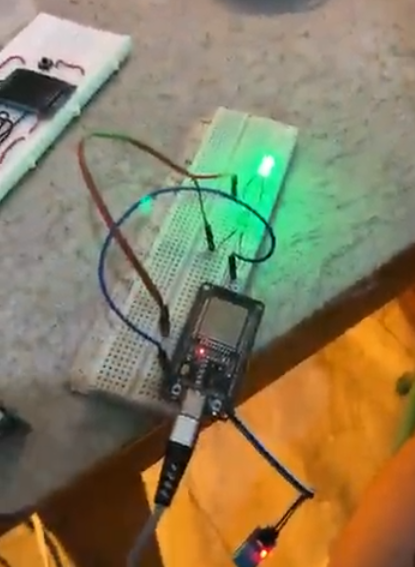
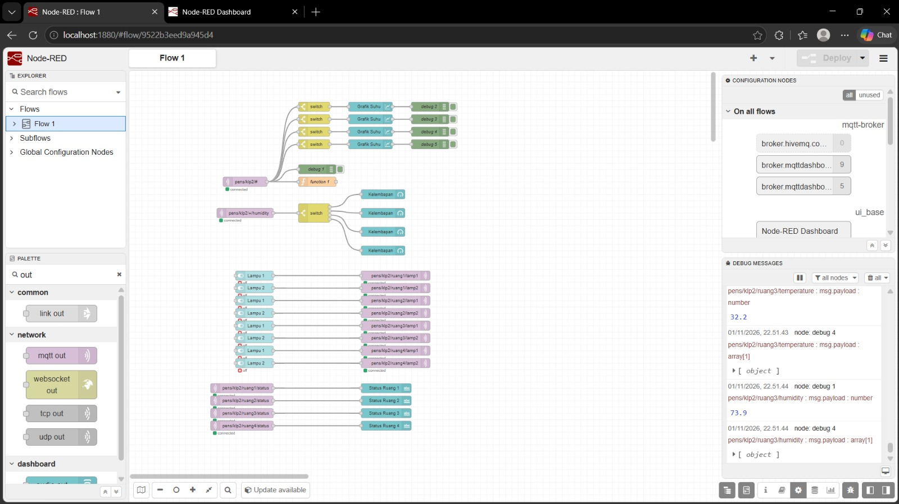
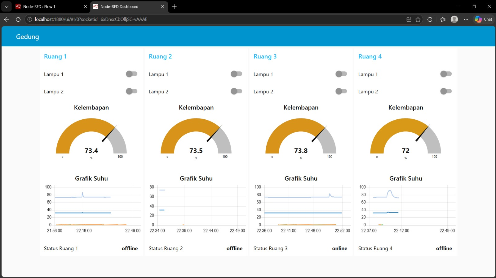

# Kel2-TugasNodeRED-ESP32

Sistem monitoring suhu dan kelembapan serta kontrol lampu untuk 4 ruangan berbasis ESP32, MQTT, dan Node-RED. Setiap ruangan memiliki satu ESP32 dengan sensor DHT11 dan 2 LED. Data dikirim ke broker MQTT, lalu ditampilkan dan dikendalikan lewat dashboard Node-RED. Status online/offline ruangan dipantau memakai Last Will (LWT) dan retained message.

## Video

- Video presentasi (maks. 7 menit): ISI_LINK
- Video demo alat (maks. 5 menit): ISI_LINK

## Anggota Kelompok 2

| Nama | NRP | Ruangan |
| ---- | --- | ------- |
| Rionajib Raditya Marzuq | 2124600081 | ruang1 |
| Muhammad Rofiul Firdaus | 2124600085 | ruang2 |
| Muhammad Rafi Kamal | 2124600080 | ruang3 |
| Mohamad Zakaria | 2124600072 | ruang4 |

## Arsitektur Sistem

```
ESP32 ruang1 ──┐
ESP32 ruang2 ──┤
ESP32 ruang3 ──┼── Broker MQTT ── Node-RED ── Browser (/ui)
ESP32 ruang4 ──┘   (ISI broker)    (client)

ESP32  -> publish : temperature, humidity, status
ESP32  -> subscribe: lamp1, lamp2
Node-RED -> subscribe: temperature, humidity, status
Node-RED -> publish : lamp1, lamp2
```

Broker yang dipakai: `ISI (mis. broker.mqttdashboard.com:1883)`

## Perangkat Keras

Komponen per ruangan:
- 1x ESP32
- 1x sensor DHT11
- 2x LED (lampu 1 dan lampu 2)
- 2x resistor 220 Ω
- Kabel jumper dan breadboard

| Komponen | Pin ESP32 | Catatan |
| -------- | --------- | ------- |
| DHT11 VCC | 3.3V | |
| DHT11 GND | GND | |
| DHT11 DATA | GPIO16 | |
| LED lampu 1 + resistor 220 Ω | GPIO25 | Anoda ke pin, katoda ke GND lewat resistor |
| LED lampu 2 + resistor 220 Ω | GPIO26 | Sama seperti lampu 1 |

Foto rangkaian satu ruangan:



## Topic MQTT

Format: `pens/klp2/<nama_ruang>/<fungsi>`

| Topic | Arah | Payload | QoS | Retain |
| ----- | ---- | ------- | --- | ------ |
| `pens/klp2/ruangN/temperature` | ESP32 → Node-RED | °C, 1 desimal | 0 | tidak |
| `pens/klp2/ruangN/humidity` | ESP32 → Node-RED | %, 1 desimal | 0 | tidak |
| `pens/klp2/ruangN/lamp1` | Node-RED → ESP32 | `1` nyala, `0` mati | 1 | tidak |
| `pens/klp2/ruangN/lamp2` | Node-RED → ESP32 | `1` nyala, `0` mati | 1 | tidak |
| `pens/klp2/ruangN/status` | ESP32 / LWT | `online` / `offline` | 0 | ya |

Wildcard di Node-RED: `pens/klp2/+/temperature`, `pens/klp2/+/humidity`, `pens/klp2/+/status`.

## Cara Menjalankan

### 1. ESP32

1. Install library di Arduino IDE (Sketch → Include Library → Manage Libraries):
   - `EspMQTTClient` oleh Patrick Lapointe
   - `DHT sensor library` oleh Adafruit (beserta `Adafruit Unified Sensor` bila diminta)
2. Buka `esp32/esp32_ruang/esp32_ruang.ino`.
3. Ubah bagian berikut sesuai kebutuhan:
   - `#define ROOM "ruang1"` → ganti `ruang1` sampai `ruang4` sesuai board (hanya ini yang diganti untuk tiap ruangan)
   - `WIFI_SSID` dan `WIFI_PASS` → isi dengan jaringan Wi-Fi yang dipakai
4. Pilih board ESP32 dan port yang sesuai, lalu upload.
5. Buka Serial Monitor (115200). Jika muncul `MQTT Connection established.`, ESP32 sudah terhubung.
6. Ulangi langkah 3–5 untuk setiap ruangan.

### 2. Node-RED

1. Jalankan Node-RED, buka `http://localhost:1880`.
2. Install paket: Menu → Manage palette → Install → `node-red-dashboard`.
3. Import flow: Menu → Import → pilih file `node-red/flows.json` → Import.
4. Pastikan server pada node `mqtt-broker` sama dengan broker di kode ESP32, lalu klik **Deploy**.
5. Buka dashboard di `http://localhost:1880/ui`.

## Screenshot

Flow Node-RED:



Dashboard:



## Hasil Pengujian

| No | Uji | Hasil | Keterangan |
| -- | --- | ----- | ---------- |
| T1 | Koneksi (`MQTT Connection established.`) | ✓ | |
| T2 | Data 4 ruang tiap ±5 detik | ✓ | |
| T3 | Chart suhu 4 garis | ✓ | |
| T4 | Sensor berubah hanya di ruang yang dipegang | ✓ | |
| T5 | Lampu tepat sasaran | ✓ | |
| T6 | Matikan lampu | ✓ | |
| T7 | Payload salah diabaikan | ✓ | |
| T8 | Status online | ✓ | |
| T9 | LWT (status jadi offline) | ✓ | |
| T10 | Retained (status tampil setelah restart Node-RED) | ✓ | |
| T11 | Reconnect otomatis | ✓ | |
| T12 | Akses dashboard dari HP | ✓ | |

## Ruangan yang Disimulasikan

Semua ruangan disimulasikan dengan memakai ESP32 secara bergantian karena hanya menggunakan 1 ESP32.

## Kendala dan Solusi

| Kendala | Solusi |
| ------- | ------ |
| ISI | ISI |
| ISI | ISI |

## Pembagian Tugas

| Anggota | Tugas |
| ------- | ----- |
| Rionajib Raditya Marzuq | ISI |
| Muhammad Rofiul Firdaus | ISI |
| Muhammad Rafi Kamal | ISI |
| Mohamad Zakaria | ISI |

## Struktur Repositori

```
Kel2-TugasNodeRED-ESP32/
├── README.md
├── esp32/esp32_ruang/esp32_ruang.ino
├── node-red/flows.json
├── docs/
│   ├── laporan.pdf
│   └── images/
└── video/LINK.md
```
